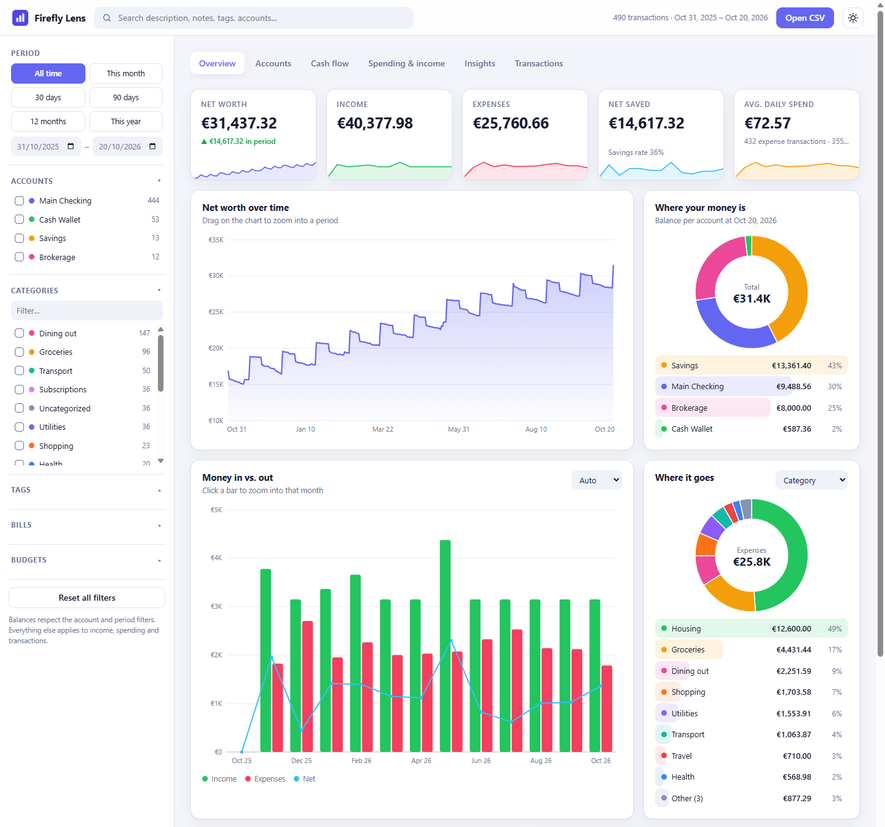
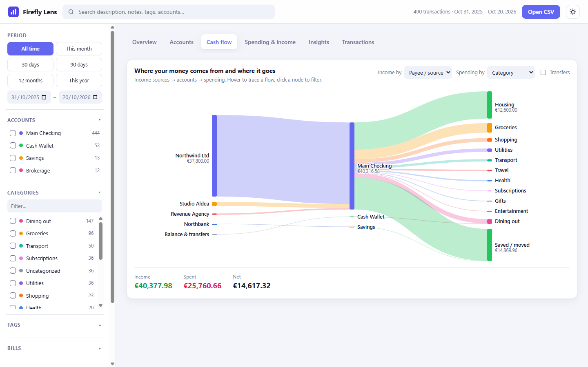
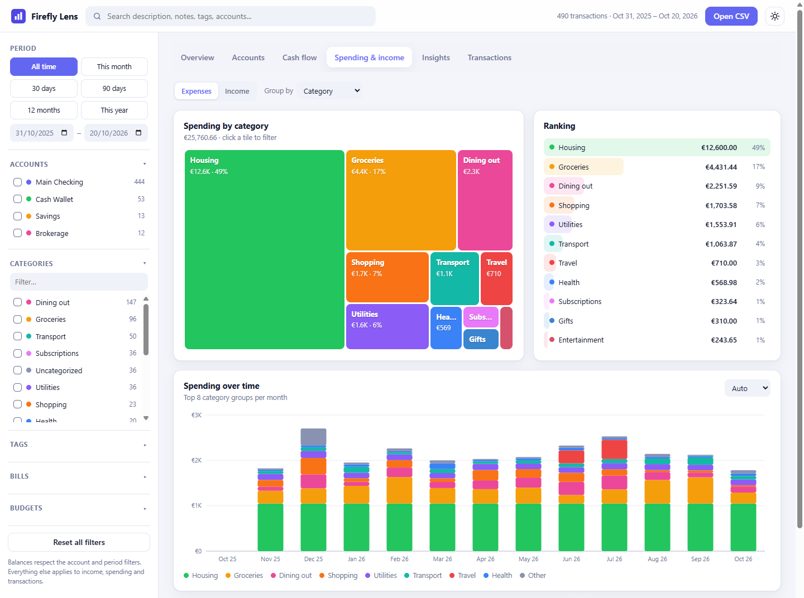

# Firefly Lens

Firefly Lens is a small tool for looking at your [Firefly III](https://www.firefly-iii.org/) finances in a clearer, more visual way. You give it the CSV file exported from Firefly III and it shows where your money is, where it comes from and where it goes, with charts you can click, filter and zoom.

It runs entirely in your web browser. There is nothing to install, no server and no Docker. Your data stays on your computer and is never uploaded.







*The screenshots use the fake data in `sample/demo_transactions.csv`.*

## Getting started

### 1. Get the app

Choose **one** of these two ways.

**Option A: download a ZIP (easiest)**

1. On the GitHub page of this project, click the green **Code** button, then **Download ZIP**.
2. Open the downloaded file and extract (unzip) it to any folder.

**Option B: clone with Git**

"Cloning" simply means downloading a copy of the project with a tool called Git.

1. Install Git from [git-scm.com](https://git-scm.com/downloads) if you don't have it yet.
2. On the GitHub page of this project, click the green **Code** button and copy the web address (HTTPS) shown there.
3. Open a terminal: **Terminal** on macOS or Linux, **PowerShell** or **Command Prompt** on Windows.
4. Go to the folder where you want the project, for example `cd Documents`.
5. Type `git clone`, a space, paste the address you copied, and press Enter:

   ```
   git clone <paste-the-address-here>
   ```

   This creates a new folder with the project inside it.

### 2. Open it

Open the project folder and double-click **`index.html`**. It opens in your normal web browser (Chrome, Edge, Firefox or Safari).

### 3. Load some data

- **Just want to look around?** Drop the file `sample/demo_transactions.csv` onto the page. It contains made-up data.
- **Want to see your own finances?** In Firefly III, open **Options → Export data** and download your transactions as a CSV file, then drop that file onto the page (or click **Choose CSV file**). You can load several files at once.

### 4. Explore, then close

Use the tabs at the top (Overview, Accounts, Cash flow, Spending & income, Insights, Transactions). When you are done, just close the browser tab. To look at another file, click **Open CSV** in the top bar.

## Tips

- **Filter** with the panel on the left (period, accounts, categories, tags, bills, budgets) or the search box. Active filters show up as chips at the top that you can remove with one click.
- **Click** a bar, slice, tile or list entry to filter by it. Every chart updates.
- **Drag** across a time chart to zoom into that period.
- **Click a transaction** to see all its details, or use **Export filtered CSV** on the Transactions tab to save what you are looking at.

## Good to know

- Opening balances count towards balances and net worth, but not towards income or expenses.
- Transfers between your own accounts are not counted as income or spending.
- If your export contains more than one currency, pick one in the left panel. One currency is shown at a time.
- Any recent version of Chrome, Edge, Firefox or Safari works.

## For developers

Plain HTML, CSS and JavaScript with no build step and no dependencies. Charts are drawn by the project's own code.

```
index.html        page shell
css/styles.css    styling (light and dark themes)
js/csv.js         CSV parser
js/model.js       data normalisation, filtering and aggregation
js/charts.js      SVG/HTML charts
js/views.js       Overview, Accounts, Cash flow
js/views2.js      Spending & income, Insights, Transactions
js/app.js         state, sidebar, filters, file loading
sample/           fake demo data
```
